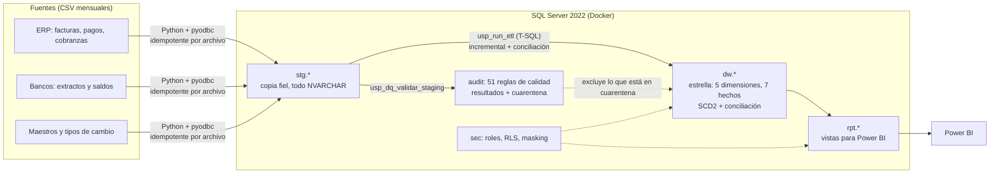

# tesoreria-dw

**Data warehouse de tesorería en SQL Server 2022** para una fintech (ficticia) de pagos transfronterizos:
pagos a proveedores, cobranzas, extractos bancarios y conciliación en ARS, USD, BRL, MXN y COP.
ETL en Python + T-SQL, control de calidad con cuarentena, conciliación bancaria automática, seguridad
(roles, RLS, masking), optimización con evidencia y capa de consumo para Power BI.

> Proyecto de portfolio. **Todos los datos son sintéticos** (generados con seed fija); bancos, empresas y cuentas son ficticios.

## El problema de negocio

Una tesorería que opera en 5 monedas y 6 bancos recibe todos los meses los extractos bancarios y los listados del ERP
(facturas, pagos, cobranzas). Con eso tiene que responder preguntas de todos los días:

- **¿Cuánta caja tengo hoy, en cada moneda?** → flujo de caja diario con saldo acumulado.
- **¿Qué pagué que el banco no debitó, y qué movió el banco que nadie registró?** → conciliación bancaria.
- **¿Cuánto me deben y hace cuánto venció?** → aging de cuentas a cobrar y DSO.
- **¿Hay pagos raros (duplicados, atípicos)?** → detección de anomalías.

El problema real son los **datos sucios**: duplicados, fechas imposibles, montos con formato regional, monedas
inconsistentes, pagos sin factura, extractos reenviados. Este proyecto los inyecta a propósito (174 errores
documentados uno por uno) y demuestra que el pipeline **los detecta todos**, los pone en cuarentena con su motivo y
cuadra los totales contra el banco.

## Arquitectura



## Cómo levantarlo (3 comandos)

Requisitos: Docker, Python 3.12 (o [uv](https://github.com/astral-sh/uv)) y, en Mac, el driver ODBC de Microsoft
([abajo](#driver-odbc-en-mac)).

```bash
git clone https://github.com/zenekax/tesoreria-dw.git
```

```bash
cd tesoreria-dw
```

```bash
./scripts/levantar.sh
```

`levantar.sh` crea el `.env` con claves aleatorias, levanta SQL Server, prepara Python, despliega la base, genera los
datos, los carga y corre el ETL completo (calidad, DW y conciliación): unos 30 segundos con la imagen de Docker ya
descargada. Es idempotente: se puede correr N veces. Probado desde un clon limpio del repo.

Después:

```bash
.venv/bin/python -m pytest python/tests -q
```

### Driver ODBC en Mac

```bash
brew tap microsoft/mssql-release https://github.com/Microsoft/homebrew-mssql-release
```

```bash
brew trust --formula microsoft/mssql-release/msodbcsql18 microsoft/mssql-release/mssql-tools18
```

```bash
HOMEBREW_ACCEPT_EULA=Y brew install msodbcsql18 mssql-tools18 openssl@3
```

El driver 18.7 necesita OpenSSL 3, y Homebrew ahora instala OpenSSL 4: `scripts/setup_python.sh` lo resuelve solo para
el venv del proyecto (detalle en la [bitácora](docs/bitacora-fases.md#fase-0-entorno-decisiones)).

## Resultados

| Área | Resultado | Cómo se verificó |
|---|---|---|
| **Calidad de datos** | **174 / 174** errores inyectados detectados (100%), precisión 97,8% (los 4 sobrantes están explicados) | tests contra el manifiesto de errores, en 2 datasets, y a escala 20 |
| **Conciliación bancaria** | **100% de precisión y recall**: 5.265 pares a escala 1 y 107.701 a escala 20 | contra la conciliación "perfecta" que deja el generador |
| **Totales de control** | filas y montos staging = DW; el saldo del banco difiere **exactamente** en las líneas en cuarentena | regla `CTL_SALDO_EXTRACTO` + test |
| **Performance** (escala 20) | Q1 flujo de caja **28x** menos lecturas · Q2 evolución de cartera **358x** · Q3 pendientes **11x** | `SET STATISTICS IO, TIME` + planes `.sqlplan` antes/después |
| **Validación de calidad** | 151 s → **5,7 s** a escala 20 (reglas ERP vs. banco rediseñadas) | bitácora del ETL |
| **Seguridad** | un analista ve solo sus monedas (RLS), CBU/CUIT/email enmascarados, sin acceso a staging | 31 tests con `EXECUTE AS` |
| **Reproducibilidad** | borrar todo y reconstruir da el **mismo DW** | huella del contenido antes/después |
| **Tests** | 234 tests (pytest), en cualquier orden | `pytest python/tests` |

### Performance

| Consulta | Cambio | Lecturas lógicas |
|---|---|---|
| Q1 flujo de caja diario | índice columnstore no agrupado (batch mode) | 4.087 → 145 |
| Q2 evolución de cartera | el índice solo: 1,1x. **Reescritura** (suma acumulada en vez de subconsulta correlacionada) + índices | 1.302.345 → 3.638 |
| Q3 partidas pendientes | índice filtrado (y `IN` en vez de `LIKE` para que el filtro se use) | 6.553 → 609 |

Detalle, tiempos y planes en [sql/07_performance/resultados.md](sql/07_performance/resultados.md).

## Decisiones de diseño (las más importantes)

1. **Staging todo en NVARCHAR y sin claves de negocio**: si `amount` fuera `DECIMAL`, el monto `1.234,56` o la fecha
   `2026-02-30` haría fallar la carga y el error nunca llegaría a los controles. Se convierte después con `TRY_CONVERT`.
2. **Calidad antes de cargar, con cuarentena**: 51 reglas set-based. Lo que viola una regla ERROR va a cuarentena
   (no se borra, y se "libera" al corregir y recargar). El ETL no descarta nada sin explicar.
3. **Estrella con los 3 tipos de hecho de Kimball**: transacción (pagos, cobranzas, movimientos), snapshot periódico
   (saldo mensual, tipo de cambio) y **snapshot acumulativo** (conciliación, con grano "partida", como la planilla de
   un tesorero). **SCD2** en contrapartes con hashes persistidos e índice único filtrado.
4. **Integridad en la base**: 30 FK verificadas y 25 CHECK de negocio (saldo que cuadra, estado de conciliación coherente).
5. **ETL en T-SQL idempotente e incremental**: transacción por paso con `TRY/CATCH` y `XACT_ABORT`, bitácora que
   sobrevive al rollback, marca de agua con ventana de reproceso; **MERGE donde es simple, UPDATE + INSERT donde hay
   lógica** (SCD2, hechos).
6. **Conciliación 1 a 1 por "mejor mutuo"**: referencia completa, referencia parcial, y monto + fecha con tolerancia por comisiones.
7. **Mínimo privilegio**: la carga no usa `sa`; el usuario del ETL solo ejecuta el orquestador; RLS y masking viajan
   hasta Power BI a través de las vistas.
8. **Todo medido**: cada optimización con planes antes/después; cada regla de calidad con recall y precisión.

## Capturas

Pendientes: el tablero requiere Power BI Desktop, que solo existe para Windows. La guía para armarlo está en
[docs/powerbi.md](docs/powerbi.md) y la lista de capturas, en [docs/img/README.md](docs/img/README.md).

## Documentación

| Documento | Contenido |
|---|---|
| [docs/datos-sinteticos.md](docs/datos-sinteticos.md) | qué se genera, realismo de tesorería y los 174 errores inyectados |
| [docs/modelo.md](docs/modelo.md) | diagrama, matriz de bus, grano de cada hecho y decisiones de modelado |
| [docs/calidad-de-datos.md](docs/calidad-de-datos.md) | reglas, cuarentena, resultados y recall/precisión |
| [docs/seguridad.md](docs/seguridad.md) | modelo de amenazas, roles, RLS y masking |
| [docs/powerbi.md](docs/powerbi.md) | tablero paso a paso: conexión, modelo, DAX y páginas |
| [sql/07_performance/resultados.md](sql/07_performance/resultados.md) | performance con evidencia |
| [docs/bitacora-fases.md](docs/bitacora-fases.md) | qué se hizo en cada fase, con hallazgos y bugs encontrados |
| [docs/uso-de-ia.md](docs/uso-de-ia.md) | cómo se usó IA y qué se verificó |
| [docs/guia-replica.md](docs/guia-replica.md) | guía para reconstruir el proyecto paso a paso |
| [docs/entrevista.md](docs/entrevista.md) | 10 preguntas de entrevista con respuestas modelo |
| [docs/REQUISITOS.md](docs/REQUISITOS.md) | requisito del puesto → dónde se demuestra |

## Estructura

```
scripts/levantar.sh        todo en un comando
scripts/run_sql.sh         despliega los .sql en orden (variables SQLCMD, base configurable)
scripts/setup_python.sh    venv + dependencias + workaround OpenSSL en Mac
python/generar_datos.py    ERP + bancos sintéticos con 174 errores inyectados
python/cargar_staging.py   CSV -> stg.* (pyodbc, fast_executemany), idempotente por archivo
python/ejecutar_etl.py     dispara dw.usp_run_etl con el usuario de mínimo privilegio
python/medir_performance.py  mide consultas antes/después (STATISTICS IO/TIME/XML)
python/tests/              234 tests (pytest)
sql/00_setup/       base, schemas, usuario ETL
sql/01_staging/     tablas stg.* y bitácora de cargas
sql/02_dw/          estrella, calendario, datos de referencia, índices
sql/03_etl/         procedimientos de carga, conciliación y orquestador
sql/04_quality/     reglas de calidad, resultados, cuarentena, controles post-carga
sql/05_security/    roles, GRANT/DENY, RLS, masking, pruebas con EXECUTE AS
sql/06_queries/     conciliación, aging, flujo de caja, top contrapartes, anomalías, PIVOT dinámico, CTE recursiva
sql/07_performance/ consultas medidas, resultados y planes
sql/08_reporting/   vistas rpt.* para Power BI
```

## Limitaciones conocidas

- Calendario sin feriados (días hábiles = lunes a viernes).
- Un pago rechazado en los últimos 5 días antes del corte no se distingue de uno en tránsito.
- El masking no es cifrado: un analista podría inferir un dato con filtros. La protección fuerte son los permisos.
- No se borran del DW las filas que desaparecen de un archivo reemplazado (solo las que pasan a cuarentena).
- El `.pbix` no está en el repo: Power BI Desktop requiere Windows (ver la guía).
