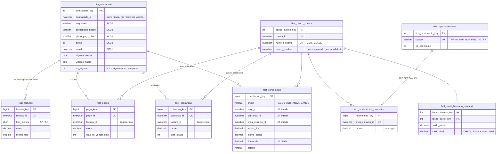

# Modelo dimensional (Fase 3)

Esquema estrella en el schema `dw`: **5 dimensiones** y **7 hechos**. Los scripts están en
`sql/02_dw/` (estructura, datos estáticos, hechos) y se despliegan con `scripts/run_sql.sh`.

> Analogía: staging es el extracto crudo abrochado en la carpeta; `dw` es el **libro
> conciliado**. Los hechos son los asientos (cuánto, cuándo) y las dimensiones son los
> maestros con los que se lee cada asiento (calendario, moneda, cuenta, contraparte, tipo de movimiento).

## Diagrama

`dim_fecha` y `dim_moneda` no están dibujadas: se relacionan con **todos** los hechos y llenarían
el diagrama de líneas cruzadas. Se ven en la matriz de bus de abajo, junto con `fact_tipo_cambio`
(que solo usa fecha y moneda).

### Matriz de bus (qué dimensión usa cada hecho)

La "bus matrix" de Kimball: las dimensiones **conformadas** (las mismas para todos los hechos)
son las que permiten cruzar procesos, por ejemplo pagos contra movimientos bancarios por fecha y cuenta.

| Hecho \ Dimensión | fecha | moneda | contraparte | banco_cuenta | tipo_movimiento |
|---|:-:|:-:|:-:|:-:|:-:|
| `fact_facturas` | emisión, vencimiento | ✔ | ✔ | | |
| `fact_pagos` | pago | ✔ | ✔ | ✔ | |
| `fact_cobranzas` | cobro | ✔ | ✔ | ✔ | |
| `fact_movimientos_bancarios` | imputación, valor | ✔ | | ✔ | ✔ |
| `fact_saldo_bancario_mensual` | cierre de mes | ✔ | | ✔ | |
| `fact_tipo_cambio` | día | ✔ | | | |
| `fact_conciliacion` | 5 hitos | ✔ | ✔ | ✔ | |

Una dimensión puede aparecer varias veces en el mismo hecho con distinto significado (*role-playing*):
`fact_facturas` usa `dim_fecha` como emisión y como vencimiento; `fact_conciliacion`, para 5 hitos.

## Grano de cada hecho

El **grano** es qué representa exactamente una fila. Es la decisión más importante: define qué se
puede sumar. Si se mezclan granos (algunas filas por pago, otras por factura), los totales se duplican sin avisar.

| Hecho | Tipo (Kimball) | Grano: una fila por... | Medidas | Responde |
|---|---|---|---|---|
| `fact_facturas` | Transacción | factura del ERP (AP o AR) | monto, monto_usd | ¿Cuánto se facturó? Base del aging |
| `fact_pagos` | Transacción | pago ejecutado (línea de la corrida F110). Una factura puede tener varios | monto, monto_usd, días vs. vencimiento | ¿Cuánto pagamos, a quién, a tiempo? |
| `fact_cobranzas` | Transacción | cobranza recibida e imputada a una factura AR | monto, monto_usd, días de atraso | ¿Cuánto cobramos, con cuánto atraso? |
| `fact_movimientos_bancarios` | Transacción | línea del extracto, una sola vez (el reenvío del banco va a cuarentena) | monto **con signo** | Flujo de caja real: `SUM(monto)` directo |
| `fact_saldo_bancario_mensual` | Snapshot periódico | cuenta bancaria × mes | saldo inicial/final, créditos, débitos | Saldo de apertura del flujo de caja; total de control |
| `fact_tipo_cambio` | Snapshot periódico | moneda × día hábil | unidades por USD | Conversión y revaluación a TC de cierre |
| `fact_conciliacion` | **Snapshot acumulativo** | **partida de conciliación** (ver abajo) | monto libro, monto banco, diferencia, días de desfase | ¿Qué está conciliado, qué falta y dónde? |

### `fact_conciliacion`: la planilla de conciliación bancaria

Es un *accumulating snapshot*: la fila **se actualiza** a medida que el proceso avanza (los otros
hechos nunca se actualizan). Replica la planilla de conciliación de un tesorero:

| Partida | Libro (ERP) | Banco | Estado |
|---|---|---|---|
| `PAY-0000123` | −5.014,60 (03/03) | −5.014,60 (04/03) | `CONCILIADA` |
| `PAY-0000456` | −1.200,00 (05/03) | −1.235,00 (05/03) | `CONCILIADA_CON_DIFERENCIA` (comisión SWIFT descontada) |
| `PAY-0000789` | −900,00 (30/10) | — | `PENDIENTE_EN_BANCO` (en tránsito o rechazado) |
| (banco) | — | +3.150,00 (12/03) | `PENDIENTE_EN_LIBROS` (nadie lo registró en el ERP) |

- Cada pago o cobranza del ERP crea una partida; cada movimiento **conciliable** del banco (transferencias)
  sin contrapartida crea la suya. Si un movimiento del ERP y uno del banco matchean, **comparten la fila**.
- Hitos, todos contra `dim_fecha`: emisión de la factura → vencimiento → registro en libros → movimiento en el banco
  → conciliación. Un hito que no pasó apunta a `-2` ("Todavía no ocurrió"), nunca a NULL.
- Montos con el signo del banco (pagos negativos), para comparar libro y banco directo. `diferencia` es una
  columna calculada (`monto_banco - monto_libro`).
- Las comisiones, impuestos y FX no se concilian contra el ERP (`es_conciliable = 0`): se explican solos.
- **Por qué este grano y no "una fila por factura"**: con facturas, los pagos parciales se resumen y los movimientos
  del banco sin factura (extractos sin match, el error más importante de una conciliación) no tienen dónde ir.

## Decisiones y su porqué

| Decisión | Por qué |
|---|---|
| **Claves surrogate `INT IDENTITY`** en dimensiones | No dependen del id de la fuente, ocupan 4 bytes en cada hecho y permiten versionar (SCD2): con el id de la fuente como clave, dos versiones de CP0012 serían imposibles. |
| **`dim_fecha` con clave `AAAAMMDD`** (excepción) | Legible, se calcula sin lookup y ordena igual que la fecha: "vencimiento ≥ emisión" es un CHECK sobre claves, sin JOIN. |
| **Miembros `-1` "Desconocido"** (y `-2` en fecha) | Un hecho sin dato apunta a -1, no a NULL: los INNER JOIN no pierden filas y los totales cierran. |
| **SCD2 en `dim_contraparte`** para segmento, riesgo, plazo y estado | Si un cliente pasó a riesgo ALTO en mayo, las cobranzas de marzo se siguen viendo como de riesgo BAJO. Cada hecho apunta a la versión vigente en su fecha. |
| **SCD1** para email, razón social, tax_id, país | Corregir un mail no cambia cómo se analiza un pago viejo: se pisa en todas las versiones. |
| `hash_tipo1` / `hash_tipo2` **persistidos** | El ETL detecta cambios comparando un hash en vez de 10 columnas (y sin el problema de `NULL <> NULL`). |
| **Índice único filtrado** `WHERE es_vigente = 1` | Garantiza una sola versión vigente por contraparte; un UNIQUE común no sirve porque hay muchas versiones cerradas. |
| **`dim_banco_cuenta` aplanada** (sin `dim_banco`) | Son 6 bancos y 9 cuentas: repetir el nombre del banco no cuesta nada y ahorra un JOIN en cada consulta y en Power BI (estrella, no copo de nieve). |
| **`DECIMAL(19,2)`** para montos, `DECIMAL(19,6)` para TC | Exacto (nunca FLOAT para plata). No `MONEY`: redondea a 4 decimales en cálculos intermedios y es propietario. |
| Monto original **+ TC + monto USD** en cada hecho | Consolida en USD sin recalcular y deja registrado con qué TC se convirtió. Para revaluar a TC de cierre está `fact_tipo_cambio`. |
| **Monto con signo** en `fact_movimientos_bancarios` | Igual que el extracto: el flujo de caja es un `SUM` sin CASE. |
| **FK declaradas y verificadas** (`is_not_trusted = 0`) | Ningún hecho puede apuntar a una dimensión inexistente, y el optimizador puede usarlas para eliminar JOINs. Cuestan algo en la carga: se acepta. |
| **CHECK de negocio en la base** (no solo en el ETL) | Montos > 0, saldo que cuadra, estado de conciliación coherente con lo que hay en la fila. Si el ETL tiene un bug, la base no lo deja pasar. |
| **Dimensiones degeneradas** (`pago_id`, `factura_id`...) | Ids de la fuente que se usan para buscar y auditar, sin tabla propia. |
| `medio_pago` como texto en el hecho | Pocos valores (SWIFT, PIX, SPEI...): no justifica una dimensión. |
| **Sin índices de consulta todavía** | Solo PK y UNIQUE de negocio (los necesita la carga idempotente). Los índices se agregan en la Fase 7 con evidencia antes/después. |
| `CREATE TABLE` **solo si no existe** | Re-ejecutar no borra datos. Un cambio de estructura sería un script de migración nuevo y numerado. |

## Limitaciones conocidas

- `es_habil` = lunes a viernes: no hay calendario de feriados (por país sería otra tabla o columnas por país).
- `semana_iso` sin año ISO: el 01/01/2021 es la semana 53 de 2020. Para agrupar por semana ISO haría falta `anio_iso`.
- No hay dimensión de medio de pago ni de país (son atributos de texto en hechos y dimensiones).

## Cómo se verifica

`python/tests/test_modelo_dw.py` (56 tests, sobre la base `TesoreriaDW_test`):

- estructura: las 12 tablas, 30 FK habilitadas y verificadas, ninguna columna `*_key` de un hecho sin FK, hashes persistidos;
- datos estáticos: calendario 2019–2027 sin huecos, atributos (día de la semana independiente de `SET DATEFIRST`,
  un único último hábil por mes), miembros -1/-2, sin duplicados al redesplegar;
- **constraints con control positivo**: primero la fila base válida entra; después, con UN campo roto, tiene que
  fallar con el código de error esperado (547 CHECK/FK, 2601 índice único, 2627 PK/UNIQUE). 27 reglas, más SCD2 y conciliación;
- contraprueba manual: se sacaron dos reglas del DDL y fallaron exactamente los dos tests correspondientes.
